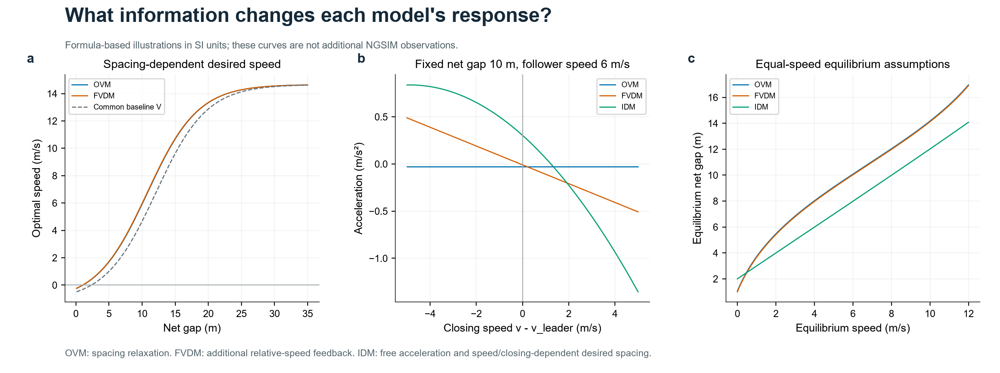
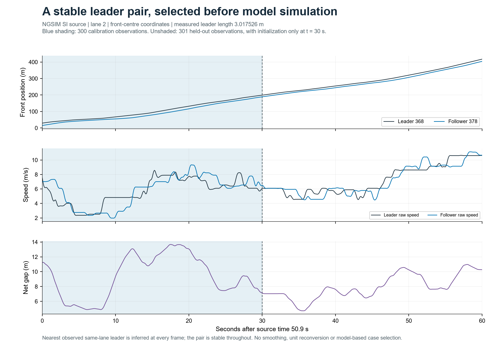
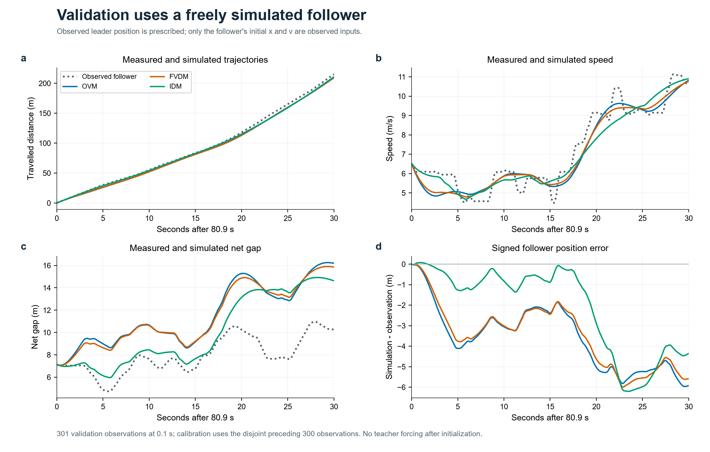
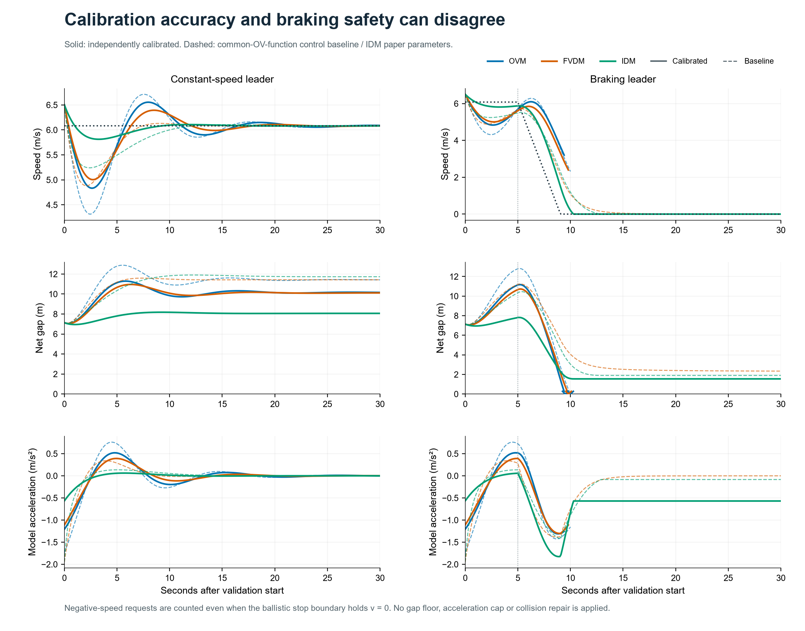
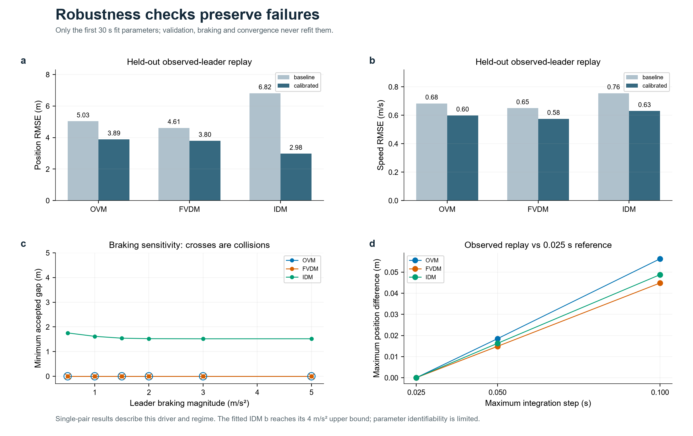
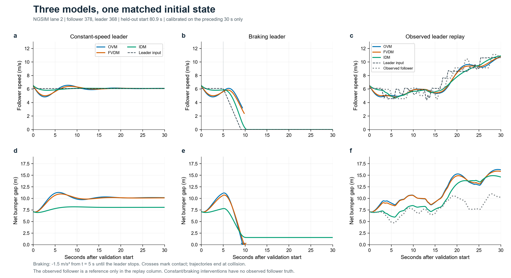

# Week05 · OVM、FVDM、IDM 跟驰模型复现与比较

三种跟驰模型的原式实现、符号量纲核验，以及同一 NGSIM 跟驰对的真实回放和前车干预实验。数据、参数、完整轨迹与失败事件均可复算。

[一页结果 PDF](results/one_page.pdf) · [全部仿真轨迹](results/trajectories.csv) · [完整指标](results/metrics.csv) · [运行与输出校验](results/reproducibility.json)

## 1. 模型复现：公式、符号、单位和参数

### 共同几何与符号

NGSIM 的纵坐标为车辆**前端中心**，沿行驶方向增大。前车记为 L、后车记为 F：

$$
h=x_L-x_F,\qquad s=h-\ell_L,\qquad c=v_F-v_L.
$$

$h$ 为车头间距，$s$ 为保险杠间的净间距，$\ell_L$ 为前车长度，单位均为 m；速度为 m/s，$c>0$ 表示后车逼近前车。三个模型输出加速度 $\dot v$，单位 m/s²。**位置差不等于净间距；速度差必须连同正负号定义一起使用。**

### OVM：间距决定期望速度，再向期望速度松弛

[Bando et al. (1995), Physical Review E 51, 1035–1042](https://doi.org/10.1103/PhysRevE.51.1035)，原文式 (1)–(2)：

$$
\ddot x_n=\alpha[V(\Delta x_n)-\dot x_n],\qquad\Delta x_n=x_{n+1}-x_n.
$$

原文忽略车长；式 (24) 使用 $V(\Delta x)=\tanh(\Delta x-2)+\tanh 2$。代码单独保留 `bando_velocity()`，在其原始缩放坐标下检查函数值。该数值尺度没有提供到 SI 的标定，不能把 2 直接当作 2 m，也不能把无量纲双曲正切输出直接作为 m/s。[原文扫描件](https://courses.physics.ucsd.edu/2014/Spring/physics221a/REFERENCES/bando.pdf)

真实数据比较中，OVM 与 FVDM **共同采用 Jiang 论文式 (5) 所引的 SI 最优速度函数**：

$$
V(s)=V_1+V_2\tanh(C_1s-C_2),\qquad\dot v_F=\alpha[V(s)-v_F].
$$

$\alpha$ 为 s⁻¹，$V_1,V_2$ 为 m/s，$C_1$ 为 m⁻¹，$C_2$ 无量纲，故加速度为 m/s²。$1/\alpha$ 是速度松弛时间，本实现没有显式反应时滞。这里复现 **Bando 的动力学结构及其有单位扩展**，不是将原文缩放参数直接移植到 NGSIM。

### FVDM：加入前后车速度差反馈

[Jiang, Wu & Zhu (2001), Physical Review E 64, 017101](https://doi.org/10.1103/PhysRevE.64.017101)，原文式 (7)：

$$
\dot v_F=\alpha[V(s)-v_F]+\lambda(h)(v_L-v_F)
=\alpha[V(s)-v_F]-\lambda(h)c,
$$

$$
\lambda(h)=\begin{cases}\lambda_0,&h\le100\ \mathrm m,\\0,&h>100\ \mathrm m.\end{cases}
$$

原文速度差为“前车减后车”：前车更慢时，该项为负，提供制动反馈；前车更快时，该项为正。$\lambda_0$ 为 s⁻¹，阈值针对**车头间距 $h$**。原文式 (5) 写作 $V(h)=V_1+V_2\tanh[C_1(h-\ell_c)-C_2]$；代码已输入净间距，不能再扣一次车长。原文同长车 $\ell_c=5$ m，本次使用实际前车长度。[作者上传原文](https://www.researchgate.net/publication/11881499_Full_velocity_difference_model_for_a_car-following_theory)

原文启动实验采用 $\alpha=0.41$ s⁻¹、$\lambda_0=0.5$ s⁻¹；其引用的 OVM 校准值为 $\alpha=0.85$ s⁻¹。**本次控制基线将 OVM 的 $\alpha$ 也设为 0.41 s⁻¹**，以隔离速度差项；该 OVM 基线不冒充文献的 0.85 s⁻¹ 参数组。

### IDM：自由加速与动态期望净间距共同作用

[Treiber, Hennecke & Helbing (2000), Physical Review E 62, 1805–1824](https://doi.org/10.1103/PhysRevE.62.1805)，原文式 (6)–(7)：

$$
\dot v_F=a\left[1-\left(\frac{v_F}{v_0}\right)^\delta-\left(\frac{s^*}{s}\right)^2\right],
$$

$$
s^*=s_0+s_1\sqrt{\frac{v_F}{v_0}}+Tv_F+\frac{v_F(v_F-v_L)}{2\sqrt{ab}}.
$$

原文速度差为“后车减前车”，正值逼近。$a,b$ 为 m/s²，$T$ 为 s，$v_0$ 为 m/s，$s_0,s_1$ 为 m，$\delta$ 无量纲。$s^*$ 四项均为 m，外层括号无量纲，最终加速度为 m/s²。$b$ 是舒适减速度参数，不是硬刹车上限。

保留 2000 年原式的 $s_1$ 项，实验按原文令 $s_1=0$；**没有加入后来常用的 $\max(0,\cdot)$ 动态间距截断**。强烈分离时原式可能出现负 $s^*$，平方后仍影响制动，不能悄悄替换为另一版本。[作者预印本：式 (6)–(8)、Table I](https://arxiv.org/abs/cond-mat/0002177)

### 本次参数与公式核验

| 参数 | 控制基线 | 训练后 OVM | 训练后 FVDM | 训练后 IDM |
|---|---|---:|---:|---:|
| $\alpha$（s⁻¹） | OVM/FVDM 均为 0.41 | 0.368989 | 0.330862 | — |
| $C_2$（无量纲） | OVM/FVDM 均为 1.57 | 1.405317 | 1.398545 | — |
| $\lambda_0$（s⁻¹） | FVDM 为 0.5 | — | 0.099712 | — |
| $T$（s） | IDM 为 1.6 | — | — | 0.996684 |
| $a$（m/s²） | IDM 为 0.73 | — | — | 0.839290 |
| $b$（m/s²） | IDM 为 1.67 | — | — | **4.0，上界** |

固定参数：OVM/FVDM 的 $V_1=6.75$ m/s、$V_2=7.91$ m/s、$C_1=0.13$ m⁻¹；IDM 的 $v_0=120$ km/h $=33.333\ldots$ m/s、$s_0=2$ m、$s_1=0$ m、$\delta=4$。IDM 基线值来自原文 Table I。所选拥堵片段不能充分识别自由流 $v_0$，因此不拟合它。

两类文献参数的自由流速度并未强制对齐：OV 函数上限为 $V_1+V_2=14.66$ m/s，IDM 的 $v_0=33.333\ldots$ m/s。本实验主要覆盖拥堵跟驰状态，不能据此比较自由流速度优劣。

核验涵盖量纲、平衡加速度为零、逼近/分离符号、$\lambda=0$ 时 FVDM 退化 OVM、100 m 阈值及原版 IDM 无 `max`。Jiang 参数的零速净距精确为 2.320374264 m；原文约 7.4 m 的车头间距是近似启动设置，未硬当作严格零点。[公式实现](model/models.py) · [数值核验结果](results/formula_checks.json)



## 2. 共同实验：NGSIM 回放、前车匀速和减速

### 数据选择与共同初态

使用上周课程包内 `NGSIM_I80_20050413_1600-1615_SI.csv`，即 2005-04-13 I-80 16:00–16:15 数据。原文件已为 m、s，未重复换算。全文件 1,226,650 行、2,052 辆车，各字段缺失数与车辆–帧重复数均为 0。[官方数据入口](https://data.transportation.gov/d/8ect-6jqj)

在 **2 号车道**逐帧将最近且严格位于前方的车辆识别为前车，要求两辆小客车、同一前车持续至少 60 s、无换道、净距≥1 m，并筛除明显速度跳变和位置/速度不一致的片段。身份由位置推断，课程 CSV 没有官方 `preceding_id`。按持续时间降序、起始时间和编号排序，在 5 个合格片段中选定 **后车 378、前车 368**；选择过程不使用模型误差。[筛选规则与审计](data/selection_audit.json) · [全部候选](data/candidates.csv)

导出 **50.9–110.9 s，601 点，间隔 0.1 s**。前 300 点（50.9–80.8 s，片段相对时间<30 s）仅训练；后 301 点（80.9–110.9 s）作独立 30 s 验证。验证初态统一为后车位置 188.995276 m、速度 6.501397 m/s；前车位置 199.146660 m、速度 6.080772 m/s、车长 3.017526 m；初始净距 **7.133858 m**。

真实回放采用观测前车位置的分段线性插值，动力学前车速度为同一曲线的分段导数，以保持运动学一致；后车初速与速度误差目标采用数据包提供的速度。位置与速度均未平滑。额外的位置导数与原始速度 RMSE 为后车 0.0408 m/s、前车 0.0415 m/s。[来源、坐标和哈希](data/manifest.json) · [跟驰片段](data/following_pair.csv)

上面的前车初速 6.080772 m/s 是原始速度列，作为匀速、减速干预的设定值；真实回放起点的动力学前车速度为 6.144780 m/s，由首段位置斜率确定。三种情景共用后车初态与初始净距；在每个情景内部，三模型共用完全相同的前车输入。速度字段与位置导数的 0.064008 m/s 初始差异保留并披露。



### 训练与场景

三个模型分别拟合，同用无量纲目标：

$$
J=\operatorname{mean}\left[\left(\frac{x_{sim}-x_{obs}}{10\ \mathrm m}\right)^2+
\left(\frac{v_{sim}-v_{raw}}{5\ \mathrm{m/s}}\right)^2\right].
$$

OVM 拟合 $\alpha,C_2$；FVDM 拟合 $\alpha,C_2,\lambda_0$；IDM 拟合 $T,a,b$。搜索边界在 [config.json](config.json) 固定，种子 20261015；257 个初始候选、8 个起点、38 轮有界坐标搜索，不保证全局最优。训练中的碰撞、负速度提议和非有限输出均判为无效候选。参数数量不同，因此误差差异同时涉及结构与拟合自由度。[参数与训练过程](results/calibration.json)

训练后冻结参数，从相同验证初态滚动 30 s，期间不再用实际后车状态纠正：

1. **前车匀速**：保持初速 6.080772 m/s，比较速度收敛与净距。
2. **前车减速**：前 5 s 匀速，随后以 −1.5 m/s² 制动至停并保持静止，约在 9.054 s 停止。
3. **真实前车回放**：输入观测前车轨迹，对照留出的实际后车计算误差。这是给定前车完整轨迹的条件回放，不等于同时预测两车未来。

匀速与减速是反事实干预，没有对应的真实后车，误差留空。只在真实回放计算误差；碰撞后轨迹也留空，不穿过前车继续仿真，不以幸存短片段冒充完整预测。

### 真实回放：预测与实际轨迹



| 模型 | 基线位置 RMSE（m） | 训练后位置 RMSE（m） | 基线速度 RMSE（m/s） | 训练后速度 RMSE（m/s） | 训练后最小净距（m） |
|---|---:|---:|---:|---:|---:|
| OVM | 5.034 | 3.887 | 0.684 | 0.599 | 7.068 |
| FVDM | 4.614 | 3.799 | 0.650 | **0.576** | 7.059 |
| IDM | 6.818 | **2.978** | 0.756 | 0.631 | 5.956 |

三者均完整回放，无碰撞或负速度边界请求；真实验证段最小净距 **4.729 m**。IDM 位置误差最低，FVDM 速度误差最低，不能用单一指标给出统一排名。因回放前车相同，净距误差与后车位置误差互为相反数，二者 RMSE 相同，不视为两项独立证据。

### 匀速与减速：响应和失败



下表用**训练后参数**，时间从共同初态起计。响应指标为前车制动后，后车首次达到 $\dot v\le-0.2$ m/s² 的采样时刻减去 5 s，输出间隔 0.1 s。它受初态与阈值影响，不能直接解释为生理反应时间。

| 模型 | 匀速最小净距（m） | 减速响应指标（s） | 减速最小净距（m） | 减速结果 |
|---|---:|---:|---:|---|
| OVM | 7.059 | 1.5 | 0.000 | 约 9.485 s 首次接触，退出 |
| FVDM | 7.051 | 1.4 | 0.000 | 约 9.816 s 首次接触，退出 |
| IDM | 6.949 | 0.5 | 1.544 | 完整完成；需要速度非负边界 |

匀速情景最后 5 s 的平均速度偏差分别为 0.0090、0.0045、0.00018 m/s，三者均接近前车速度。减速情景中，训练后 OVM、FVDM 响应不足并接触，IDM 较早制动并保持正净距。

**拟合改善不等于制动更安全。**FVDM 控制基线 $\lambda_0=0.5$ s⁻¹ 在同一减速情景保持最小净距 2.337 m；仅将这个基线的速度差反馈改为 0，其余参数不变，就在约 10.002 s 接触。该受控消融支持速度差反馈在本情景的作用。独立拟合后 $\lambda_0$ 降到 0.0997 s⁻¹，同时 $\alpha,C_2$ 也改变，真实速度误差虽下降，减速却失效；不能将所有变化只归因于 $\lambda_0$。[反馈消融](results/feedback_ablation.csv)

IDM 完成制动依赖明确的速度非负边界：若恒加速度步将产生负速度，积分到准确停止位置并令速度为零。训练后情景记录 **395 次负速度提议，只有 1 次停车事件**；大量提议发生在停车之后，不能解释成 395 次停车。没有加速度硬上限、净距修补或期望间距 `max`；状态 `requires_nonnegative_speed_boundary` 单独保留，不能将修正后的完成冒充未处理原式自动物理可行。[全部指标与失败记录](results/metrics.csv)

加速度图展示原式请求值。停车后该值仍可能为负，而速度非负边界使实际速度保持零；这时请求加速度不等于实际速度导数。

### 步长与制动强度敏感性



主步长 0.05 s，采用恒加速度弹道更新；用相同参数以 0.1、0.05、0.025 s 复算。主步长与 0.025 s 在共同有效时段的最大位置差 **0.0340 m**、速度差 **0.0168 m/s**；OVM/FVDM 在三种步长下均接触，主步长接触时刻与最细步长相差约 0.0110/0.0117 s。IDM 制动最小净距分别为 1.551/1.544/1.540 m。速度边界请求数随步数增加，不能当作与步长无关的行为频次。[收敛结果](results/convergence.csv)

另测试前车减速度幅值 0.5、1、1.5、2、3、5 m/s²。训练后 OVM、FVDM 在这些测试中均接触退出；IDM 均保持正净距，但均需要非负速度边界。此处仅检验这组初态与参数，不构成普遍安全保证。[制动敏感性](results/braking_sensitivity.csv)

### 复现与文件

在仓库根目录使用 Python 3.12：

```bash
python -m pip install -r week05/requirements.txt
python -m week05.model.run
```

保留提交结果的独立复算与测试：

```bash
python -m week05.model.run --output .local/week05_reproduce
python -m pip install pytest==9.1.1
python -m pytest -q tests/test_week05_models.py tests/test_week05_results.py
```

若有教师原始 ZIP，可运行 `python -m week05.model.prepare "第4周_NGSIM-I80_课堂数据.zip"`，默认将重生结果写到忽略的本地目录，核验时不会覆盖随附输入。PNG 图和一页 PDF 均由同一运行入口生成。PDF 默认嵌入 Windows 宋体；其他系统可用环境变量 `TRAJ_CJK_FONT` 指向可嵌入的中文 TTF/TTC 字体。

仓库包含必要的 60 s 跟驰数据，普通复算无需再次下载完整 NGSIM。核心文件：

- [config.json](config.json)：实验条件、参数边界和随机种子。
- [models.py](model/models.py)、[simulation.py](model/simulation.py)：公式、输入、积分与失败处理。
- [calibration.py](model/calibration.py)、[prepare.py](model/prepare.py)：训练段拟合、原始数据筛选。
- [metrics.csv](results/metrics.csv)、[trajectories.csv](results/trajectories.csv)：两组参数×三模型×三情景的全部结果。
- [experiment.json](results/experiment.json)、[manifest.json](data/manifest.json)：初态、指标定义、数据来源与哈希。

## 3. 总结：能反映什么，不能据此证明什么



**OVM** 展示“间距—期望速度—速度松弛”的机制，可比较均速跟随、速度恢复、净距和轨迹误差。它缺少直接逼近速度反馈，本次减速响应偏晚并接触；其当前拟合参数不足以代表紧急制动能力。

**FVDM** 额外反映速度差反馈对响应、净距和速度误差的影响。受控基线消融显示制动收益，而本片段拟合出的低增益在减速干预中失效，说明拟合目标、参数与干预表现需要共同检查。速度差项不等于碰撞安全保证，真实误差低也不能替代压力测试。

**IDM** 可解释期望时间间隔、静止净距与逼近时附加制动，输出速度、净距和停止过程。本次位置 RMSE 最低且减速保持正净距，但需要速度非负边界；拟合 $b=4.0$ m/s² 达到预设上界，说明该片段尚不能充分约束此参数，不能将它解释为驾驶员真实舒适减速度。有限拥堵片段也不能识别自由流期望速度。

共同可计算净时间间隔 $s/v$（仅 $v>0.1$ m/s）、逼近 TTC $s/(v_F-v_L)$（仅逼近速度>0.1 m/s）、加减速度范围、阈值响应及首次碰撞时刻。TTC 是条件性替代安全指标，不是事故概率；停车时不强行给出有限时距。这里 $s/v$ 是**净时间间隔**，不同于 $h/v$ 的车头时距。

只有一个无换道跟驰对和一个连续片段，301 个验证点具有时间相关性，不是 301 次独立实验。因此不能直接证明车流容量、基本图、扰动波速、车队稳定性、换道机制或跨驾驶员模型排名。当前完成原式实现、符号量纲核验和受控场景验证，未声称逐图重现三篇论文全部实验。推广需要多跟驰对、独立场景及明确的安全约束。

**AI 辅助说明：**使用 Codex 辅助检索原文、核对公式、编写仿真绘图代码和整理文档；未用第三方跟驰实现替代公式核验。参数与结论来自随附数据的实际计算，保留碰撞、边界请求和参数触界，没有人工修改轨迹以改善结果。
