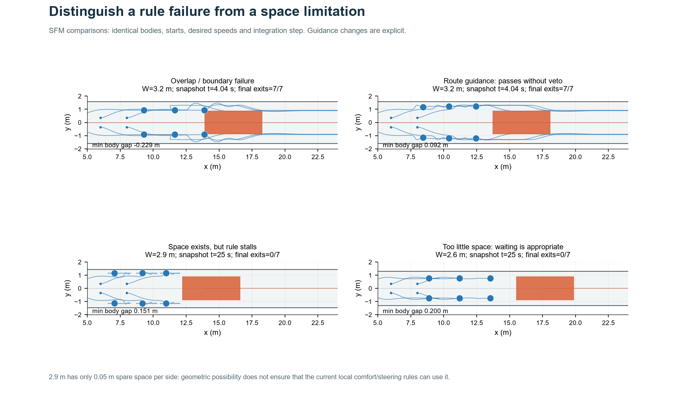
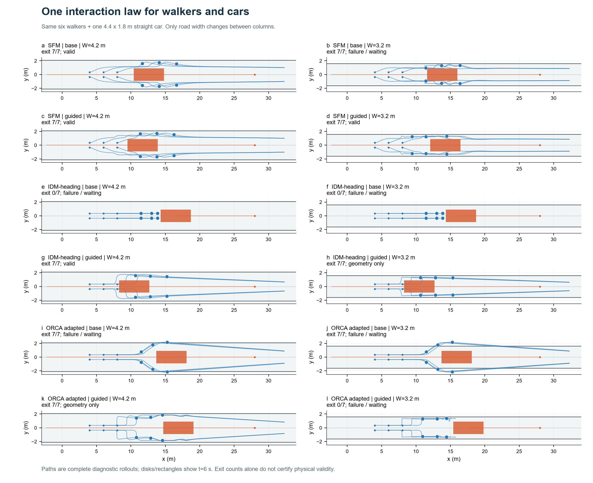
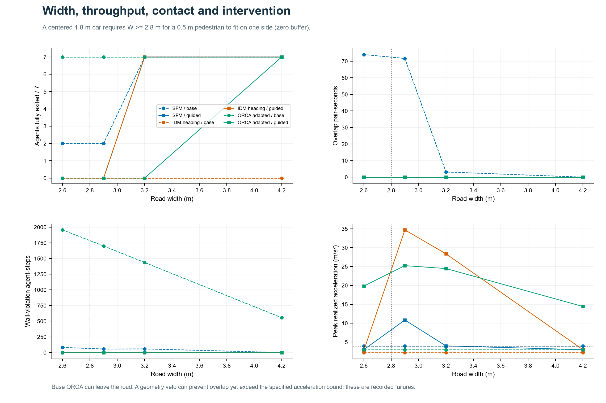
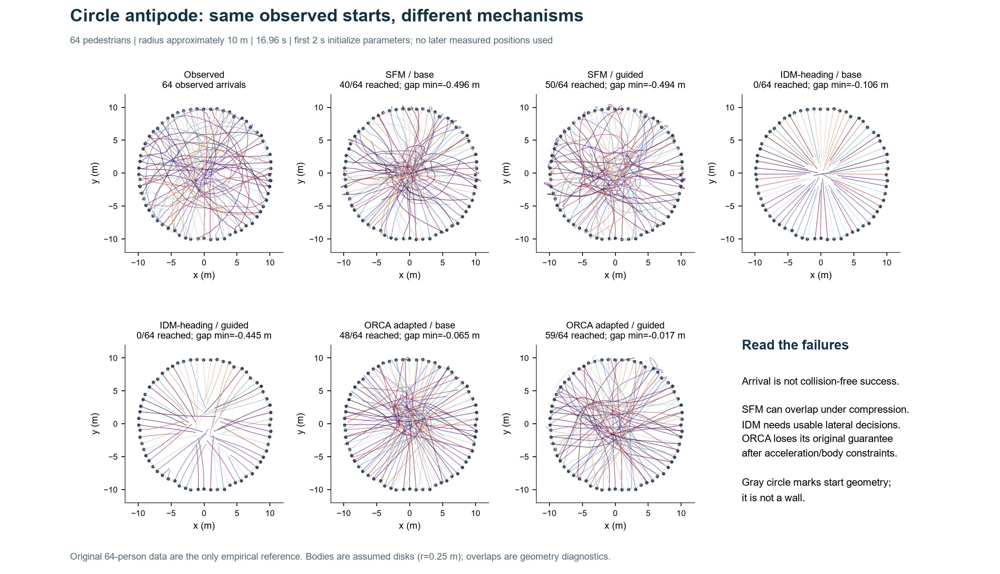
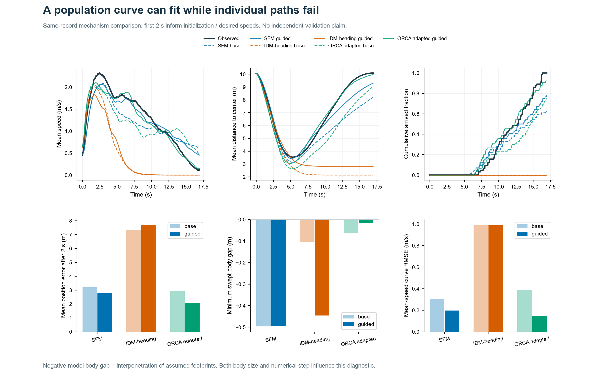
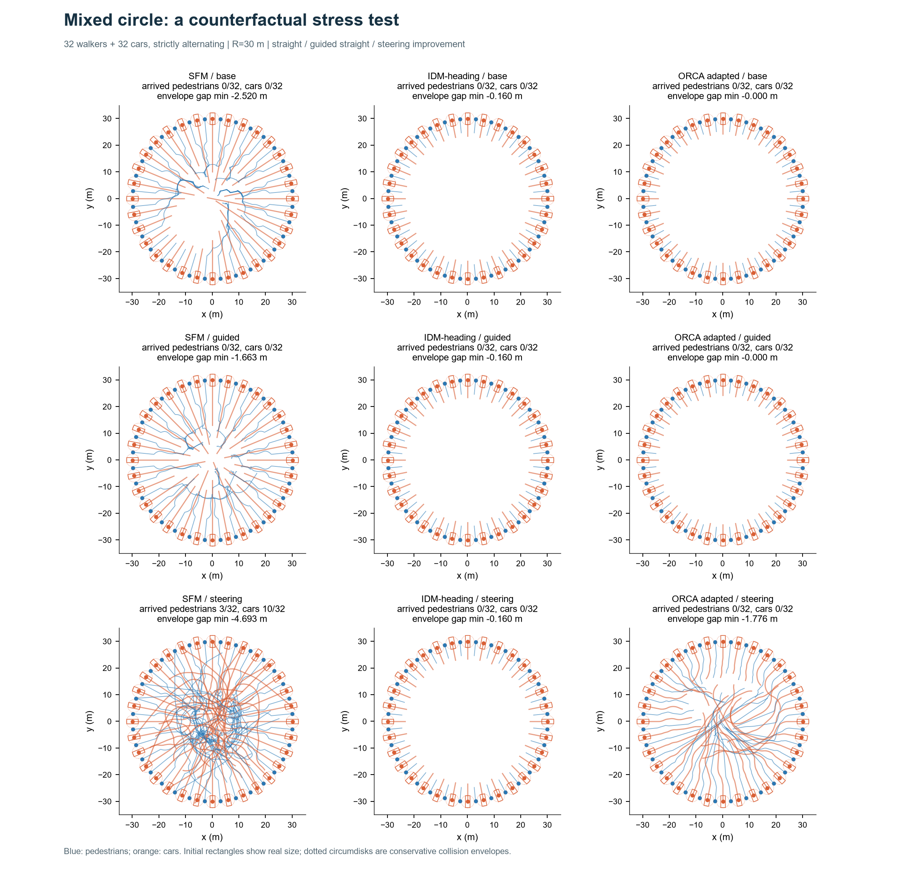
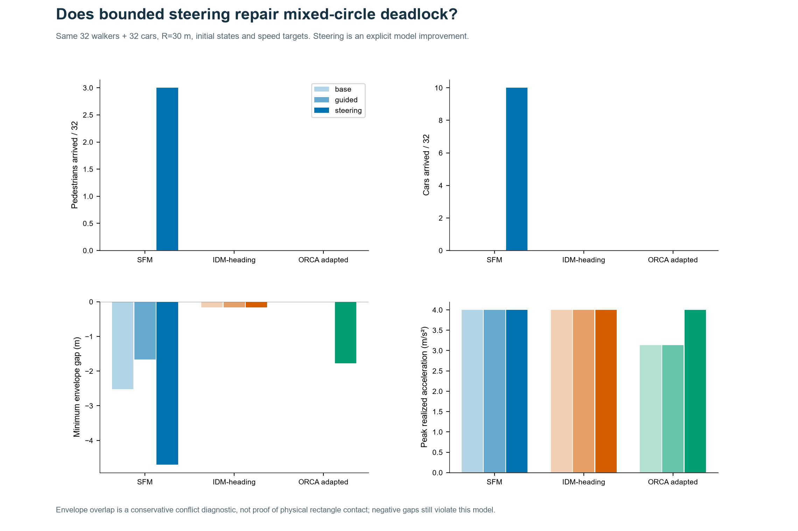
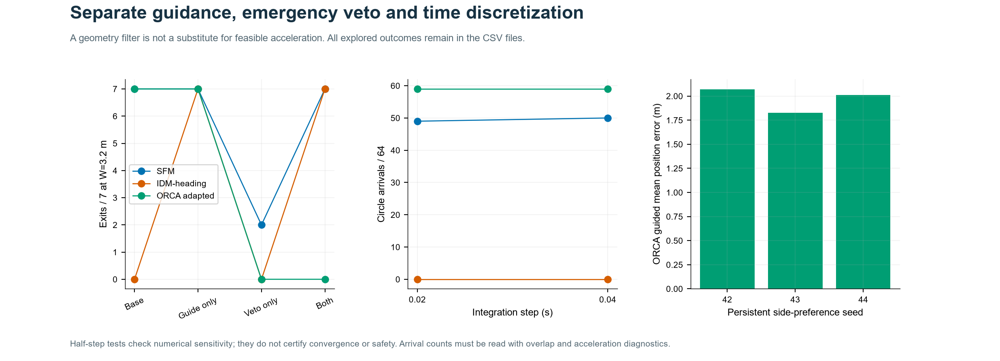

# Week 06 · 用同一个模型描述人和车

**问题：同一套交互公式，配上不同的身体尺寸与行动能力，能否同时解释人车避让？**

本周比较 **社会力 SFM、方向扩展 IDM、适配 ORCA** 三类模型。每一组实验中的所有主体都调用同一个模型，共 **39 组主实验 + 17 组消融与敏感性实验**。窄路中汽车保持直线；混合圆环设置 **32 人＋32 车严格交替、半径 30 m**，分别比较基础直行、引导直行、**有限转向改进模型**。真实 64 人实验仅作纯行人参照。

**主要发现：**改良 SFM 在 3.2 m 窄路中让 6 人和 1 车全部通过，用时 **25.52 s**，无身体重叠、越界或规定加速度超限。圆环中改良 ORCA 的群体曲线与实测最接近，但仍有身体重叠；统一交互公式尚不足以保证统一、合理的运动。

[一页汇报 PDF](results/one_page.pdf) · [窄路动画](results/narrow_comparison.gif) · [交替人车圆环动画](results/mixed_comparison.gif) · [纯行人实测对照动画](results/circle_comparison.gif) · [全部指标](results/metrics.csv) · [可运行代码](model)



## 先看懂：模型怎样工作，改了什么？

- **SFM 社会力：**每个主体想以期望速度走向目标；离别人或边墙太近时受到“排斥”。把这些加速度相加得到下一步运动。人和车都用这条公式，但车辆不能像行人一样随意横移。
- **IDM-heading：**沿当前想走的方向找最近的阻挡者，根据自身速度、剩余净距和接近速度决定加速或刹车。它原本擅长纵向跟驰，**不会自动决定该往哪边绕**，因此本次显式补上方向选择。
- **ORCA：**预测当前速度是否会在未来一段时间导致碰撞，排除危险速度，再选择尽量接近期望速度的解。它会要求双方各承担一半避让；车辆做不到任意横移时，这个假设容易失效。

| 实验中的版本 | 保留什么 | 新加什么 | 想解决的问题 |
|---|---|---|---|
| 基础版 `base` | 同一个 SFM / IDM-heading / ORCA 核心；尺寸与加速度约束 | 不加侧向通路或风险偏转；车辆只能沿初始方向行驶 | 直接移植模型时，会碰撞、越界还是互相等待？ |
| 窄路改良 `guided` | 与基础版相同的交互核心和初态 | 行人先侧移至车外通路；汽车对占用直行走廊者减速；空间不足时等待；另记录几何干预 | 将“知道要避让”变成可执行的通路选择 |
| 混合圆环引导 `guided` | 车辆仍只能沿初始直径；同样的身体与速度参数 | 用当前相对运动预测最近接近风险，并产生固定侧偏的期望方向 | 检查只改善避让意图、不改变车辆运动能力是否足够 |
| 混合圆环转向改进 `steering` | 完全保留圆环引导版的交互和风险规则 | **只为车辆增加有限转向能力**；角速度、等效转角和横向加速度均有限制 | 检查车辆能逐渐转弯后，能否执行原先做不到的绕行 |

**举例：**行人迎面遇车时，基础 IDM 可能只会停；窄路引导版先给行人一个“向侧面走到车身之外”的期望方向，再让同一个 IDM 计算该方向上的速度。混合圆环的转向版则让车头每步最多转过允许角度，**不是直接给车辆一个任意横向速度**。

下面的“改进”表示增加了某项机制，**不保证结果更好**。本次转向模型在混合圆环中仍失败，原因和违规数如实列出。读图时蓝色为人、橙色为车；混合圆环图的三行依次是基础直行、引导直行、有限转向，三列依次为 SFM、IDM、ORCA。

## 1 · 使用什么模型，统一到哪一层？

统一的是“由邻居状态计算下一步运动”的交互核心；**尺寸、期望速度、加速度界限和可行动作仍因主体而异**。车辆实际尺寸为 4.4 × 1.8 m，行人使用半径 0.25 m 圆盘。窄路使用精确矩形几何；混合圆环使用车辆外接圆作为保守碰撞包络，允许在改进模型中受限转向。所有位置均为身体中心，单位统一为 m、s、m/s、m/s²。

每个时间步同步读取全部主体状态，计算期望速度、交互响应、行动约束，再更新：

```math
\mathbf v_i^{n+1}=\mathcal C_i(\mathbf v_i^n+\Delta t\,\mathbf a_i^n),\qquad
\mathbf x_i^{n+1}=\mathbf x_i^n+\Delta t\,\mathbf v_i^{n+1}.
```

ORCA 直接给出候选速度，再经过同一个行动约束算子 $\mathcal C_i$。改良窄路实验另有显式几何干预；其引起的加速度超限单独记录，不能当作模型自然产生的合理运动。

### 社会力 SFM：目标驱动与身体排斥

```math
\mathbf a_i=\frac{\mathbf v_i^{pref}-\mathbf v_i}{\tau_i}
 +\sum_{j\ne i} A\exp(-g_{ij}/B)\,\mathbf n_{ij}
 +\mathbf a_i^{wall}.
```

$g_{ij}$ 是有符号身体表面净距，重叠时为负；$\mathbf n_{ij}$ 从邻居指向自身。$A=4$ m/s²，$B=0.5$ m；边墙项使用 $A_w=4$ m/s²、$B_w=0.15$ m。$\tau_i$ 单位为秒，因此全部项均为加速度。

这是受 Helbing–Molnár 社会力框架启发的**圆形指数排斥简化版**，并非逐字复现 1995 年论文中的椭圆势函数。这里的 $A$ 已按质量归一化，不能解释为牛顿。它能自然表现减速、绕行与压缩，但软排斥不保证无重叠。

### IDM-heading：将纵向跟驰公式投影到当前期望方向

令 $\mathbf e_i$ 为期望运动方向，$u_i=\max(\mathbf v_i\cdot\mathbf e_i,0)$。沿该方向搜索身体可能相交的最近邻居；对向邻居的投影速度可以为负，闭合速度定义为 $\Delta u_i=u_i-\mathbf v_j\cdot\mathbf e_i$。

```math
s_{i}^{\ast}=s_{0}+\max\!\left(0,u_{i}T+
\frac{u_{i}\Delta u_{i}}{2\sqrt{a_{i} b_{i}}}\right),
\qquad
a_{i}^{\parallel}=a_{i}\left[1-\left(\frac{u_{i}}{u_{i}^{\mathrm{pref}}}\right)^4
-\left(\frac{s_{i}^{\ast}}{s_{i}}\right)^2\right].
```

```math
\mathbf a_i=a_i^{\parallel}\mathbf e_i-
\frac{\mathbf v_i-u_i\mathbf e_i}{\tau_i}.
```

$s_0=0.15$ m、$T=0.6$ s；$a_i,b_i$ 为加速和减速参数，单位 m/s²。射线搜索添加 0.03 m 横向缓冲；矩形采用扩张包围盒，圆盘采用射线—圆相交。计算时净距下限 0.02 m、期望速度下限 0.05 m/s 仅用于防止除零，实际重叠仍按原身体几何记录。

此处采用作者当前说明中的**非负动态间距版本**，与第五周按原论文核验的版本区分。方向选择、横向速度松弛以及对向速度投影是本次明确增加的二维扩展，不能称为原始 IDM 已具备的横向避让能力。期望速度为零时另用停车松弛项。

### ORCA：选择尽量接近期望速度的避碰速度

```math
\mathbf v_i^{ORCA}=\arg\min_{\mathbf v\in
 \bigcap_j H_{ij},\,\|\mathbf v\|\le v_i^{max}}
 \|\mathbf v-\mathbf v_i^{pref}\|^2 .
```

预测时域为 2 s；$H_{ij}$ 为相邻主体各承担一半避让责任形成的速度半平面。复用第二周 RVO2/ORCA 线性规划求解器。

圆盘使用自身半径；车辆沿相对位置方向 $\mathbf n$ 使用支撑长度 $h_x|n_x|+h_y|n_y|$ 构造近似约束。**这不是精确矩形速度障碍物。**随后施加汽车不能横移、加速度有限等限制，可能破坏原可行解；原始圆盘 ORCA 的安全保证不再直接成立。道路边界也没有被并入原 ORCA 半平面，基础版越界被保留为可见失败。

## 2 · 场景与参数

### 场景一：六名行人与一辆汽车迎面相遇

| 项目 | 固定设置 |
|---|---|
| 道路 | 长 32 m，中心线 $y=0$，两端开放，无路口和信号 |
| 路宽 | **4.2、3.2、2.9、2.6 m**；其他初态和参数保持一致 |
| 行人 | 6 人；起点 $(4,\pm0.35),(6,\pm0.35),(8,\pm0.35)$ m；向右 1.4 m/s |
| 汽车 | 起点 $(28,0)$ m；向左 3 m/s；身体 4.4 × 1.8 m |
| 运动能力 | 行人向量加速度 ≤3 m/s²；汽车加速 ≤1.5、制动 ≤4 m/s²；汽车横向速度为零 |
| 松弛与速度 | 行人 $\tau=0.5$ s，汽车 $\tau=1$ s；最大速度为期望速度的 1.2 倍且不低于初速 |
| 数值设置 | 同步更新，$\Delta t=0.04$ s，持续 40 s；0.02 s 另做敏感性检验 |
| 完成定义 | 行人整个身体越过右出口、汽车整个身体越过左出口；完成后移出交互系统 |

运行前的预测保存在 [config.json](config.json)：4.2 m 有充足侧向空间；3.2 m 仍可通过但更易冲突；2.9 m 接近几何极限；2.6 m 应等待。居中汽车两侧各能容纳一个 0.5 m 宽行人的零缓冲条件为：

```math
W_{\min}=1.8+2\times0.5=2.8\ {\rm m}.
```

这是**车辆始终居中且不倒退**的本场景限制，不是所有道路的通用通行阈值。2.9 m 只有每侧 0.05 m 余量，舒适距离和避让规则仍可能无法利用这点空间。

### 场景二：严格交替的人车圆环，纯行人实测作参照

真实对照沿用第二周 [circle-10m-64-1.txt](../week02/model/data/circle-10m-64-1.txt)：64 人、425 帧、25 fps、16.96 s。初始圆半径约 **10.07 m**，每人目标为初始位置关于拟合圆心的对跖点。初速取前 0.2 s，期望速度沿用前 1–2 s 位移估计；后续不读取观测未来位置来引导运动。

所有模型使用相同初态、目标、身体半径、随机侧偏种子。圆环是**从初态出发的同记录机制比较**，不是独立预测验证；前 2 s 参与初始化，位置 ADE 因此只统计 $t>2$ s。沿用第二周的右侧偏好概率 0.65 也曾参考此记录，不能作为独立验证参数。

本次混合仿真采用半径 **30 m** 的 **32 人 + 32 车交替圆环**：64 个等角度起点，偶数位置为车、奇数为人，每个主体走向对跖点，持续 **80 s**。行人期望速度 1.4 m/s、汽车 3 m/s，保持与窄路一致；其他能力参数也不变。它没有真实混行轨迹，且半径与速度结构不同，**不计算相对于纯行人实测的 ADE/FDE**。

车辆几何外接圆半径 $r_c=\sqrt{2.2^2+0.9^2}=2.377$ m。30 m 半径下相邻起点弦长约 2.944 m，大于人车包络半径和 2.627 m，初始无重叠；原 10 m 半径无法容纳同样的交替包络。这是扩展道路尺度的几何依据。外接圆包含整个车身，无包络重叠足以保证矩形不相交；反之包络重叠**不能直接证明实际矩形已相撞**，但仍违反本次求解采用的保守约束。

对每种交互核心分别运行三版：`base` 无预判、车辆沿初始直径；`guided` 有预判、车辆仍沿初始直径；`steering` 保留相同预判并加入车辆有限转向，**它是明确的改进模型，不属于基础版能力**。直行版本中的对向汽车不能彼此穿过，因此合理停车也是允许的结果。

有限转向先得到同一交互核心的候选速度，再限制车头方向增量：

```math
|\Delta\theta|\le\Delta t\min\left(0.35,\,
\frac{v\tan(30^\circ)}{2.7},\,
\frac{2.0}{\max(v,0.1)}\right).
```

三个约束分别来自最大角速度 0.35 rad/s、轴距 2.7 m/最大转角 30°、最大横向加速度 2 m/s²。车辆沿限幅后的车头方向推进，不能瞬间横移；同时保留加减速界限。此为受自行车几何启发的运动学限制，未建完整轮胎/转向执行器动力学。实际转向与加速度违规由指标核查，不预先假定改进一定成功。

逐主体初态、目标和参数见 [initial_conditions.csv](results/initial_conditions.csv)，数据哈希与实验设置见 [experiment.json](results/experiment.json)。

## 3 · 改良规则：输入、触发和动作

| 环节 | 输入与触发 | 具体动作 |
|---|---|---|
| 窄路侧向通路 | 对向且不可横移邻居的尺寸、位置、道路宽度；汽车右端 $x$ 减行人 $x$ 处于 −0.8～15 m | 按行人初始所在侧选择通路；先纯侧移至车身外，再前进，避免浅对角线仍把汽车识别为阻挡前车 |
| 通路余量 | 行人中心可达上界 $W/2-r-0.02$ 与车外所需距离 $0.9+r$ | 可通时保留最多 0.08 m 通过余量；空间不足且纵向差小于 11 m 时，双方期望速度设为零 |
| 汽车让行 | 前方直行走廊仍被行人身体占据，横向额外缓冲 0.10 m | 按 $v_{\rm cap}=\sqrt{2b\max(s-0.8,0)}$ 限制期望速度；走廊清空后恢复 |
| 圆环预判 | 当前相对位置、当前速度、期望速度；未来 4 s 内的最近接近时间与距离 | 风险取 $\exp[-(d_{\rm miss}/1{\rm m})^2](1-t_{\rm ca}/4{\rm s})$；按个体固定侧偏将期望方向转动最多 0.35 rad |
| 窄路几何干预 | 下一步完整线段上的身体扫掠、道路边界 | 限制下一步越界；预测净距小于 0.002 m 时暂停涉事主体，最多检查四轮；干预次数和实际加速度单独统计 |

上表只改变期望运动和共同约束，**没有把行人的模型换成另一种模型**。圆环不施加窄路几何干预，因此可以直接观察模型的重叠问题。所有规则使用当前/过去状态及已知目标；真实圆环的前 2 s 参数初始化另行披露。

几何干预是诊断性补丁，瞬间改速度会造成不合理急停。为区分效果来源，在 3.2 m 中补做“仅通路规则”和“仅几何干预”：改良 SFM 即使去掉几何干预，仍以完全相同的 **25.52 s、0.092 m 最小净距**完成通行；其改善来自通路决策。仅靠几何干预的 SFM 只能退出 2 人，并出现 **59.14 m/s²** 的不合理峰值加速度。

## 4 · 窄路结果：通过不等于成功



下表“人数/车数”为完全退出路段的数量；† 表示出现身体重叠、越界或规定加速度超限，不能算有效通行。未通过仅表示在 40 s 时限内未完成。

| 模型 | 版本 | 4.2 m 人/车 | 3.2 m 人/车 | 2.9 m 人/车 | 2.6 m 人/车 |
|---|---|---:|---:|---:|---:|
| SFM | 基础 | 6/1 | 6/1 † | 2/0 † | 2/0 † |
| SFM | 改良 | 6/1 | **6/1** | 0/0 † | 0/0 |
| IDM-heading | 基础 | 0/0 | 0/0 | 0/0 | 0/0 |
| IDM-heading | 改良 | 6/1 | 6/1 † | 0/0 † | 0/0 |
| ORCA 适配 | 基础 | 6/1 † | 6/1 † | 6/1 † | 6/1 † |
| ORCA 适配 | 改良 | 6/1 † | 0/0 † | 0/0 † | 0/0 † |

**3.2 m 的失败与修复。**基础 SFM 虽然全部退出，但最小净距为 **−0.229 m**，并发生越界。改良后净距最低 **0.092 m**，全体退出用时由无效的 22.44 s 变为有效的 **25.52 s**，没有触发几何干预。等待与绕行有代价，较快的穿透结果不能作为优势。

**其他模型的不合理。**基础 IDM 能减速却没有自主选择侧向通路，宽路也会僵持；改良 IDM 在 3.2 m 能退出，但最大实际加速度 **28.36 m/s²**，来自边界干预，不能算物理合理。基础 ORCA 靠越界绕行获得表面通行；改良版在 3.2 m 停滞，在 4.2 m 虽全部退出，仍有 **14.43 m/s²** 的干预峰值。

**空间不足与规则不足。**2.9 m 几何上留有窄小通路，但改良 SFM/IDM 在 40 s 内仍未通过，提示舒适距离、横移和制动规则存在冲突。2.6 m 无法并行通过，改良 SFM 与 IDM 保持不重叠、不越界、无加速度超限的等待，符合本设定的空间约束；ORCA 的等待仍含急停问题。



## 5 · 圆环结果：轨迹形状、群体曲线与失败一起看



| 模型 | 版本 | 到达人数 / 64 | 2 s 后 ADE（m）↓ | 平均速度曲线 RMSE（m/s）↓ | 最小身体净距（m） |
|---|---|---:|---:|---:|---:|
| SFM | 基础 | 40 | 3.213 | 0.308 | −0.496 |
| SFM | 改良 | 50 | 2.803 | 0.198 | −0.494 |
| IDM-heading | 基础 | 0 | 7.329 | 0.993 | −0.106 |
| IDM-heading | 改良 | 0 | 7.700 | 0.990 | −0.445 |
| ORCA 适配 | 基础 | 48 | 2.920 | 0.387 | −0.065 |
| ORCA 适配 | 改良 | **59** | **2.069** | **0.150** | **−0.017** |

实测 64 人均到达。预判和固定侧偏帮助 SFM、ORCA 形成绕行，减少聚集；IDM 的方向规则仍不能解决密集相向主体中的互相阻挡，改良版位置误差甚至略大。改良 ORCA 的平均距圆心曲线 RMSE 为 **0.341 m**，但个体位置 ADE 仍有 2.069 m；群体曲线相似并不意味着每条轨迹都重合。

**六组圆环模型均出现假设身体的重叠。**负净距是圆盘假设下的几何违规，不等于已从视频确认实际人的碰撞；这里也不把模型重叠之后继续计算得到的到达数当作无碰撞成功。



### 32 人＋32 车交替：有限转向改进对照

以下九组使用相同 64 个起点、半径、期望速度、身体包络与时长，仅改变预判和转向能力。到达者进入目标 0.5 m 内即记到达，仍保留在场景中；所有完整轨迹均显示。人车分别统计，防止少数主体的通过掩盖整体僵持。

| 统一核心 | 版本 | 到达行人 / 32 | 到达车辆 / 32 | 最小包络净距（m） | 加速度超限主体步数 |
|---|---|---:|---:|---:|---:|
| SFM | 基础直行 | 0 | 0 | −2.520 | 0 |
| SFM | 引导直行 | 0 | 0 | −1.663 | 0 |
| SFM | **有限转向改进** | 3 | 10 | −4.693 | 41 |
| IDM-heading | 基础直行 | 0 | 0 | −0.160 | 0 |
| IDM-heading | 引导直行 | 0 | 0 | −0.160 | 0 |
| IDM-heading | **有限转向改进** | 0 | 0 | −0.160 | 0 |
| ORCA 适配 | 基础直行 | 0 | 0 | 约 0（容差内） | 0 |
| ORCA 适配 | 引导直行 | 0 | 0 | −0.000201 | 0 |
| ORCA 适配 | **有限转向改进** | 0 | 0 | −1.776 | 30 |

**转向能力增加不等于任务成功。**SFM 的转向版使 3 人和 10 车到达，但伴随严重包络穿透与 41 个加速度超限主体步，不能称为有效通行。IDM 很早就制动，其转向意图也随低速减弱，仍无法打破僵持。ORCA 基础直行保持包络不重叠而等待；转向版将速度避碰解再做转向投影后失去可行性，增加了冲突且无人到达。

三种转向版均满足所实现的角速度、转角等效界限和横向加速度界限，但 SFM/ORCA 仍有加速度超限：**先限制加速度、再限制方向，不能保证两个可行集合的交集。**这说明车辆的避碰和动力学必须联合求解，单纯给行人式模型补上“能转弯”仍不足以合理统一人车。这里没有将失败的改进隐藏，也未用纯行人轨迹误差给混行版本打分。





## 6 · 复核、敏感性与纠错



- **规则消融，6 组：**仅通路、仅几何干预分别应用于三种模型。SFM 的通路规则独立有效；IDM/ORCA 去掉边界干预后虽能退出，却越界，不能将其算作改良成功。
- **步长减半，9 组：**3.2/2.6 m 窄路三模型，以及真实圆环三模型。SFM 在 3.2 m 仍有效通行，用时 25.52→25.16 s；圆环 ORCA 到达数均为 59，ADE 2.069→2.083 m，最小净距 −0.0175→−0.0044 m，仍非严格安全。IDM 窄路干预加速度从 28.36 增到 59.58 m/s²，说明补丁没有随步长减小变得合理。
- **侧偏种子，2 组补充：**ORCA 改良版种子 42/43/44 的圆环到达数为 59/63/62，ADE 为 2.069/1.828/2.013 m。没有以较好种子替换主结果，也没有用三个种子宣称统计显著。
- **一次实质纠错：**检查双车扩展时，发现矩形—矩形净距必须使用两车半尺寸之和，而不能只减一辆车的尺寸。已修正几何距离、射线阻挡与扫掠检测，并加入“双矩形相隔/相交”单元测试，再重新运行全部实验。
- **完整身体与连续步检测：**检查整个时间步线段上的最小身体净距，避免只看帧端漏掉穿透；窄路只有整个身体退出才记完成，退出后从交互中移除。

指标定义：净距为建模身体/包络的有符号表面距离，混合圆环取保守外接圆；重叠 pair-seconds 是各主体对发生步内重叠的步长之和，**不是精确碰撞持续时间**；越界 agent-seconds 亦为步采样累计量。重叠判断容差为 $10^{-5}$ m，因此 ORCA 基础直行的约 $-4.9\times10^{-8}$ m 不计违规。等待指速度低于 0.1 m/s 的未完成时长。几何有效完成要求全体退出/到达且无重叠/越界，再满足规定加速度与转向界限才标为 `physically_feasible_complete`；这个字段只涵盖本实验的检查项，不等价于完整车辆动力学认证。完整定义在 [simulation.py](model/simulation.py)，敏感性数值在 [additional_studies.csv](results/additional_studies.csv)。

## 7 · 统一建模得到什么认识？

**同一交互核心是可实现的，但不能抹去行动能力差异。**SFM 对不同主体都能表达目标趋近和空间排斥，IDM 都能表达闭合速度驱动的制动，ORCA 都能表达未来碰撞风险。只把主体类型换成参数，仍无法自动获得正确的路线选择、让行权、车辆转向能力和不可穿透约束。

本次最可靠的局部成果是 **SFM + 可通行通路决策**：在 3.2 m 中修复了基础版的重叠与越界，且改善不依赖瞬时几何干预。它尚不能解决 2.9 m 僵持，也不能在密集圆环中保证无重叠。IDM 的主要缺口是二维方向决策；ORCA 的主要缺口是将身体形状、运动能力和避碰可行域一起求解。

进一步改良应把**可达速度集合、精确车身几何、显式让行优先级**放进决策过程，而不能只在最后把速度截断。没有横移或退让空间时，合理等待比穿透后“全部通过”更符合交通行为。本次为有限场景的机制实验，未进行多场景标定，不能宣称已建立普适的人车统一模型。

## 8 · 运行与文件

在仓库根目录执行，已验证 Python 3.12：

```bash
python -m pip install -r week06/requirements.txt
python -X utf8 -m week06.model.run
```

默认重算 39 组主实验、17 组补充实验、8 张结果图、3 个 GIF 与一页 PDF。本机约数分钟，速度取决于环境。输入沿用第二周 TXT，**不需要联网下载**。仅重画已有结果可用 `--figures-only`；`--no-gif`、`--no-studies` 可跳过动画或补充实验。`--only` 仅用于开发，不生成完整交付。

不覆盖已提交结果的独立复算与测试（PowerShell）：

```powershell
python -m pip install pytest==9.1.1
python -X utf8 -m week06.model.run --output .local/week06_reproduce --no-gif --no-studies
$env:WEEK06_RESULTS=".local/week06_reproduce"
python -m pytest -q tests/test_week06_models.py tests/test_week06_results.py
Remove-Item Env:WEEK06_RESULTS
```

- [model/](model)：几何、三类核心、场景、同步仿真、补充实验、绘图与报告；[config.json](config.json) 保存统一参数。
- [results/](results)：图、动画、一页报告、完整轨迹 NPZ、指标 CSV、初始化和来源记录；[reproducibility.json](results/reproducibility.json) 保存环境版本及输出哈希。
- 测试覆盖身体距离、单步穿透、双车几何、车道能力约束、相同初态、有效完成判据、来源哈希与独立复算。
- 本地验证：全仓库 **86 项通过、6 项条件跳过**；另在独立输出目录重跑全部 39 组主实验，Week06 **20 项检查全部通过**，数值指标与提交结果一致。八张结果图和一页 PDF 已实际打开检查。
- 复用 `week02/model/analysis.py` 的圆环读取/评估、`orca.py` 的 RVO2 线性规划、`week01/style.py` 的图形样式；不复制一份圆环原始数据。

## 资料与 AI 辅助

1. Helbing, D. & Molnár, P. (1995). *Social force model for pedestrian dynamics*. [论文 DOI](https://doi.org/10.1103/PhysRevE.51.4282) · [作者预印本](https://arxiv.org/html/cond-mat/9805244v1)。
2. Treiber, M., Hennecke, A. & Helbing, D. (2000). *Congested traffic states in empirical observations and microscopic simulations*. [DOI](https://doi.org/10.1103/PhysRevE.62.1805) · [作者 IDM 公式说明](https://traffic-simulation.de/info/info_IDM.html)。
3. van den Berg, J. et al. (2011). *Reciprocal n-body collision avoidance*. [作者 ORCA 项目](https://gamma.cs.unc.edu/ORCA/) · [使用的 RVO2 版本](https://github.com/snape/RVO2/blob/1c25b27258d191e26c2df83ff6e31abc8efbdaed/src/Agent.cc) · [Apache-2.0 许可证](../week02/model/RVO2-LICENSE.txt)。
4. Xiao 等（2018）圆环对跖实验：[arXiv:1808.01443v1](https://arxiv.org/html/1808.01443v1)。实际输入为课程提供的同名轨迹 TXT；设置核验与数据来源见 [第二周说明](../week02/README.md)。

AI（Codex）辅助资料检索、公式适配、代码编写、图文整理和核查。上文区分了原始模型、二维/形状扩展及新增行为规则；所有数值来自保存的仿真运行，失败、越界、重叠与不合理急停均保留。模型与数据的来源和权利范围见 [NOTICE](../NOTICE.md)。
