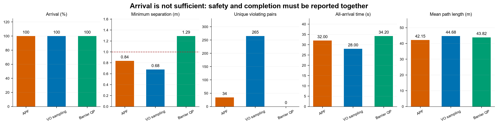
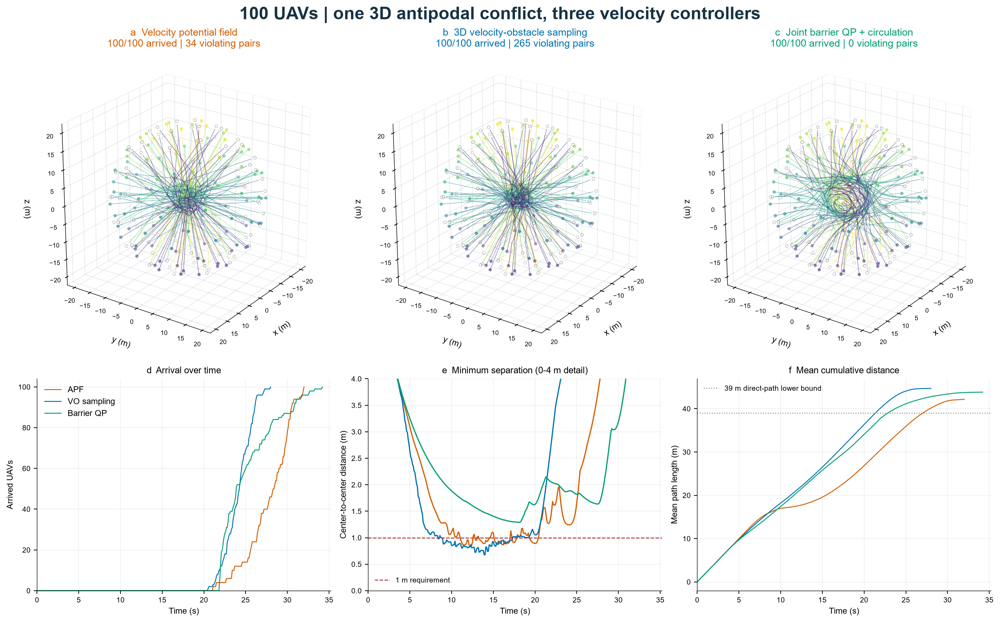
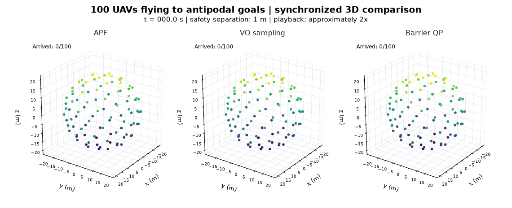
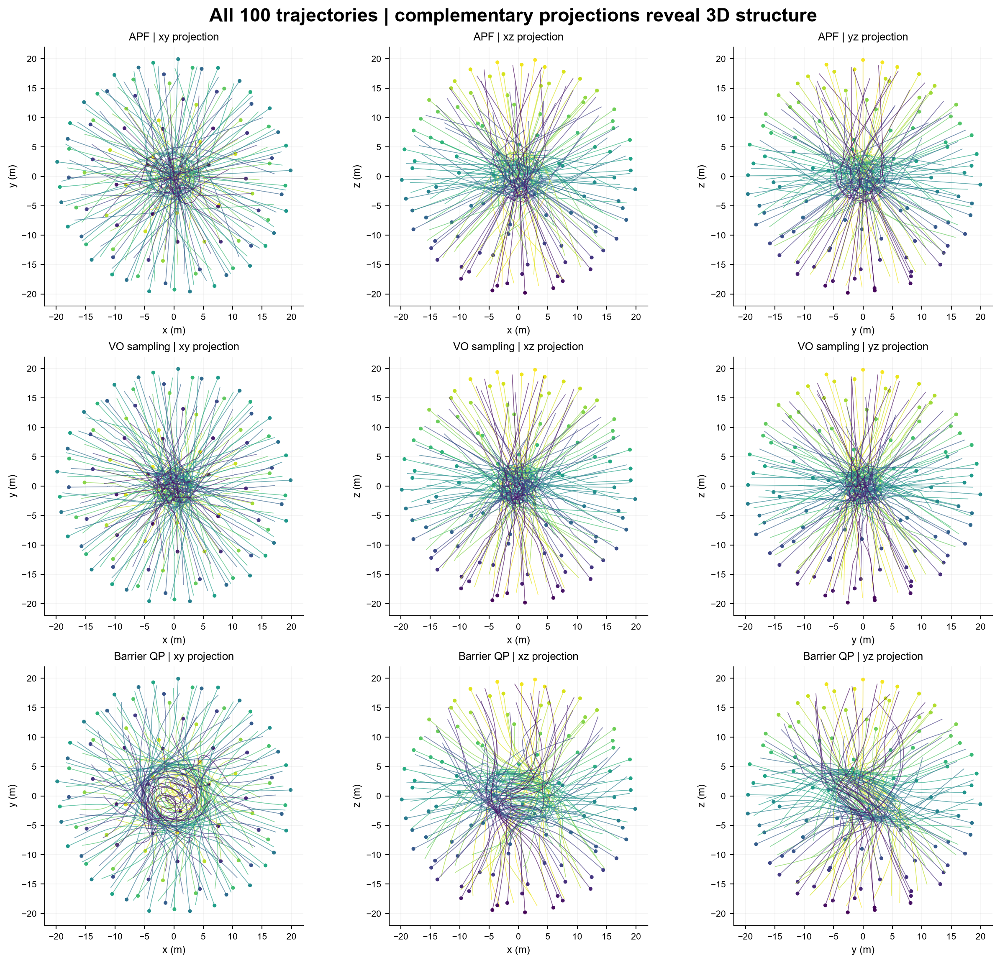
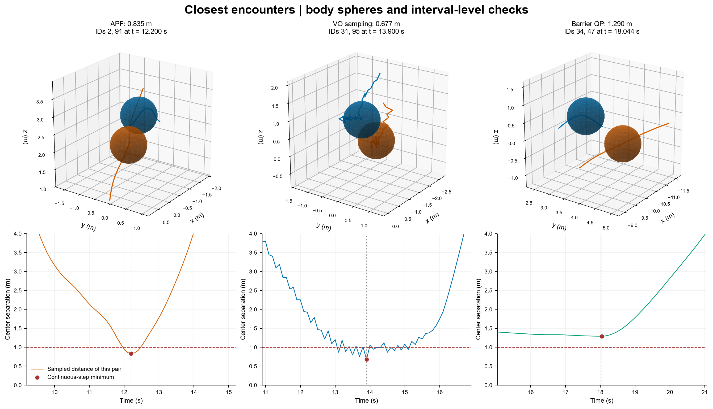

# Week 07 · 100 架无人机的三维对跖冲突

**任务：** 100 架无人机近似均匀分布在球面，同时飞向各自对跖目标。比较三种直接输出三维速度的算法，判断能否在 120 s 内保持至少 1 m 间隔并全部到达。**不考虑重量、推力、力、加速度与姿态动力学。**

**本次结果：** 联合屏障速度优化 + 绕行引导在 **34.2 s** 内安全完成 **100/100 架**，最小中心间隔 **1.290 m**，侵入机对数 **0**。另外两种方法也全部到达，但违反间隔要求，保留为失败对照。另完成四组补充验证。

[轨迹与时间曲线](results/overview.png) · [三维动画](results/comparison.gif) · [指标 CSV](results/metrics.csv) · [可运行代码](model) · [复核测试](../tests/test_week07.py)

## 1 · 先理解算法：每一步怎么决定速度？

所有算法使用同一批初始位置和目标。每一步先读取全体旧状态，再计算所有新速度，最后同步更新：

```math
\mathbf{p}_{i}^{k+1}=\mathbf{p}_{i}^{k}+\Delta t\,\mathbf{u}_{i}^{k},
\qquad \|\mathbf{u}_{i}^{k}\|\leq 2\ \mathrm{m/s}.
```

位置单位为 m，时间为 s，速度指令为 m/s。初始速度为 0，允许第一步直接改变速度。期望速度 $`\mathbf{v}_{i}^{\mathrm{goal}}`$ 指向目标，模长不超过 2 m/s。距目标中心 ≤1 m 后，后续速度固定为 0，**仍留在原地作为障碍物**。

| 方法 | 观察什么 | 怎样决策 | 主要局限 |
|---|---|---|---|
| 速度型人工势场 APF | 目标方向、当前邻居距离 | 目标速度加近邻排斥速度，再限速 | 软规则不能保证 1 m |
| 三维速度障碍物采样 VO | 位置、邻居上一时刻速度 | 检验未来 5 s 的候选速度，选接近目标的安全候选 | 同时换速破坏恒速预测；有限采样可能无解 |
| 联合屏障速度优化 CBF-QP | 全体位置、目标及绕行方向 | 同时优化 100 架机的 300 个速度分量，约束两两分离 | 需要全局状态与集中计算；安全不自动保证无死锁 |

### A. APF：用近邻距离修正速度

令 $`d_{ij}=\|\mathbf{p}_{i}-\mathbf{p}_{j}\|`$，$`\mathbf{n}_{ij}=(\mathbf{p}_{i}-\mathbf{p}_{j})/d_{ij}`$ 是远离邻居的单位向量：

```math
\mathbf{u}_{i}=\mathrm{cap}_{2}\left[
\mathbf{v}_{i}^{\mathrm{goal}}+
\eta\sum_{j\neq i}\max\!\left(\frac{1}{\max(d_{ij},0.05)}-\frac{1}{d_0},0\right)
\mathbf{n}_{ij}\right].
```

$`d_0=3`$ m，$`\eta=3`$ m²/s；$`\mathrm{cap}_{2}`$ 保持方向，将速度模长限制到 2 m/s。距离项为 1/m，乘以增益后为 m/s，**公式直接输出速度，没有牛顿力、质量或加速度积分**。0.05 m 是防止除零的数值下限。

越靠近邻居，向外的速度修正越强；3 m 外不修正。这是受人工势场思想启发的课程速度场实现，不是原论文控制器的逐项复现。它不预测未来，因而不使用预测时域 $`\tau`$。

### B. VO：检查未来 5 s 会不会接近得过头

每架机生成至多 **92 个候选速度**：目标速度、半速目标速度、旧速度、零速度；目标方向周围 15°/35°/65° 各 8 个方向；32 个球面方向分别取 2 和 1 m/s。候选可能重复。

对候选速度 $`\mathbf{c}`$ 与邻居旧速度 $`\mathbf{v}_{j}`$，令 $`\mathbf{q}=\mathbf{p}_{j}-\mathbf{p}_{i}`$、$`\mathbf{w}=\mathbf{c}-\mathbf{v}_{j}`$：

```math
t_{\mathrm{ca}}=\mathrm{clip}
\left(\frac{\mathbf{q}\cdot\mathbf{w}}{\|\mathbf{w}\|^2},0,\tau\right),
\quad d_{\mathrm{pred}}=\|\mathbf{q}-t_{\mathrm{ca}}\mathbf{w}\|,
\quad \tau=5\ \mathrm{s}.
```

相对速度为零时取当前距离。若对所有邻居都有 $`d_{\mathrm{pred}}\geq1`$ m，该候选被认为安全；安全候选中最小化：

```math
J(\mathbf{c})=\|\mathbf{c}-\mathbf{v}_{i}^{\mathrm{goal}}\|^2
+0.1\|\mathbf{c}-\mathbf{v}_{i}\|^2.
```

检查 21 m 内邻居即可，因为相对速度至多 4 m/s，5 s 内至多闭合 20 m。没有安全候选时，选择预测最小间隔最大的候选，记录失败搜索；没有碰撞后推开或瞬移修补。

这是三维有限候选 VO，**不是 ORCA**。双方没有共同求解相容的新速度，不能沿用 ORCA 的互惠避碰保证。

### C. 联合屏障优化：把所有人的速度放进同一个问题

先增加绕行意图。固定单位轴 $`\mathbf{a}=(0.3,0.5,1)/\|(0.3,0.5,1)\|`$，绕行方向 $`\mathbf{c}_{i}=(\mathbf{a}\times\mathbf{p}_{i})/\|\mathbf{a}\times\mathbf{p}_{i}\|`$；轴上退化时该项为零。强度为：

```math
\beta_i=2\exp\!\left[-\left(\frac{\|\mathbf{p}_{i}\|}{9\ \mathrm{m}}\right)^2\right]
\min\!\left(\frac{\|\mathbf{g}_{i}-\mathbf{p}_{i}\|}{5\ \mathrm{m}},1\right)
\ \mathrm{m/s}.
```

越接近球心，绕行意图越强；接近目标时消失。将目标速度与绕行速度相加并限速，得到名义速度 $`\bar{\mathbf{v}}_{i}`$。这也是速度方向规则，不是力。

接着对全体速度同时求解：

```math
\min_{\mathbf{u}_1,\ldots,\mathbf{u}_{100}}
\frac12\sum_i\|\mathbf{u}_i-\bar{\mathbf{v}}_i\|^2,
\qquad
\mathbf{n}_{ij}\cdot(\mathbf{u}_i-\mathbf{u}_j)
\geq-\frac{d_{ij}-D}{\tau},
\quad D=1.05\ \mathrm{m},\quad\tau=5\ \mathrm{s}.
```

全部 **4950 个无序机对** 参与约束：越接近内部保护距离 1.05 m，允许的相互接近速度越小。额外 0.05 m 是算法余量，评价阈值仍为题目的 1 m。

OSQP 求解时限制每个速度分量在 ±2 m/s，已到达者固定为 0。求解后若有模长超过 2 m/s，**全部速度乘同一个比例缩小**。当前距离 ≥D 时约束右侧非正，共同缩速保留两两约束；逐架分别裁剪没有这一性质。因此输出是“QP + 共同限速”，不宣称是精确球形速度约束下的最优解。

理想精确解满足约束，且当前距离 ≥D、$`0\leq s\leq\Delta t\leq\tau`$ 时，步内沿当前连线方向的投影距离满足：

```math
\mathbf{n}_{ij}\cdot[\mathbf{p}_{i}-\mathbf{p}_{j}+s(\mathbf{u}_{i}-\mathbf{u}_{j})]
\geq d_{ij}-\frac{s}{\tau}(d_{ij}-D)\geq D.
```

三维距离不小于该投影，因而得到分段直线运动下的几何依据。代码还检查求解状态、约束残差和实际步内最小距离；求解或残差检查失败时全体暂时停一步，次数如实记录。这是一阶速度级安全屏障的独立适配，不照搬加速度受限机器人的论文保证。

## 2 · 共用场景与参数

图片未指定球半径，本次设为 **20 m**。Fibonacci 球面点用等面积高度带和黄金角方位角，近似均匀铺满球面，**不只在赤道上画一圈**。起点半径都为 20 m，最近邻距离 6.181–6.855 m，初始无侵入；目标为各自位置的相反数。

| 项目 | 设置 |
|---|---|
| 数量、空间 | 100 架；球心 (0,0,0)，R=20 m，近似均匀球面 |
| 目标 | 每架机的对跖点，所有目标互不重合 |
| 安全半径 / 评价间隔 | 每架 0.5 m / 两机中心距离至少 1 m |
| 最大速度 / 初速 | 2 m/s / 全部为 0 |
| 时间 | Δt=0.1 s；VO 预测及屏障约束时域 τ=5 s；最长 120 s |
| 完成与停止 | 距自身目标 ≤1 m 后停留，不移除、不再启动 |
| 环境 | 同步更新；自由三维空间，无静态障碍、地面限制、通信时延或观测噪声 |
| 数值约定 | 间隔容差 10⁻⁶ m；QP 绝对/相对容差均 10⁻⁶，最多 4000 次迭代 |

全部到达后提前结束；保持悬停至 120 s 不改变本题五项指标。设置见 [config.json](config.json)，逐机坐标、目标与初速见 [initial_conditions.csv](results/initial_conditions.csv)。

## 3 · 按题目计算五项指标

间隔均为 **三维中心距离**。对每个时间段利用相对位置和相对速度求解析最小值，防止两帧之间互相穿过而漏检。

| 指标 | 计算口径 |
|---|---|
| 到达率 | 截止 120 s，曾进入自身目标 1 m 球内的数量 / 100 |
| 最小间隔 | 全部无序机对、全部运动时间段的最小三维中心距离 |
| 侵入间隔的机对数 | 曾出现距离 <1−10⁻⁶ m 的不同无序机对数；同一对多次侵入只计一次 |
| 全部到达时间 | 100 个首次到达时刻的最大值；未全到达则留空，不以 120 s 冒充 |
| 平均累计路程 | 逐架累计三维位移模长，再对全部 100 架平均；到达后不再增长 |

只有“全到达且侵入机对数为零”记为安全完成。额外保存重复侵入的机对步数、逐机到达时间和路程，不与“不同机对数”混用。

| 模型 | 到达率 | 最小间隔 (m) ↑ | 侵入机对数 ↓ | 全到达 (s) ↓ | 平均路程 (m) ↓ | 安全完成 |
|---|---:|---:|---:|---:|---:|---|
| APF 速度势场 | 100% | 0.835 | 34 | 32.00 | 42.149 | 否 |
| 三维 VO 采样 | 100% | 0.677 | 265 | 28.00 | 44.681 | 否 |
| 联合屏障优化 + 绕行 | 100% | **1.290** | **0** | 34.20 | 43.818 | **是** |



VO 的 28 s 最快，但侵入了 265 对安全间隔，不能因此认定最好。联合优化用 34.2 s 安全通过，平均路程比进入目标区域的直线路程下界 39 m 增加约 12.4%。比较的是完整控制策略，联合优化还含显式绕行规则，下面用消融区分它的作用。

## 4 · 全部轨迹与同步动画



上排每幅都画出全部 100 条轨迹，实点为起点、空心点为目标；颜色对应起始高度，同一架机跨模型保持同色。下排依次为累计到达数、每段运动最小间隔、平均累计路程；间隔曲线显示 0–4 m 细节，红线为 1 m。



动画采用相同仿真时刻和空间范围，约 2 倍速播放，尾迹约 2 s；先到达的模型停留等待另外两组。点是中心位置，全景点大小不代表 0.5 m 安全半径；下一节局部图才按比例画安全球。

<details>
<summary>展开：全部轨迹的 XY / XZ / YZ 三视图</summary>



</details>

## 5 · 失败与成功的原因



**APF 是软排斥。** 目标吸引与多邻居修正共同作用，仍可能进入 1 m 内。第一段违规是 11.0–11.1 s 的 8/81 号机，间隔从 1.011 降至 0.952 m；全程最小值为 0.835 m。绕开中心不等于满足严格间隔。

**VO 的恒速预测与同步换速不一致。** 第一段违规是 8.3–8.4 s 的 2/7 号机：对这一机对，分别假设对方保持旧速度时，预测最小间隔为 1.065、1.094 m；同时执行新速度后实际只有 0.981 m。该例直接展示单方面恒速预测的缺口。另外有 **1531 个机—步** 没有找到采样安全解，只能回退到预测间隔最大的候选。有限采样、无解回退与同步响应均需改进，不能推广为所有 VO 方法均不安全。

**联合优化同时约束双方的新速度。** 提前减小接近速度，配合共同绕行方向缓解中心拥挤。主实验没有求解/残差失败和保护停车回退。但它依赖全局位置与集中计算；本次不代表任意数量、通信延迟或真实飞行动力学下都能完成。

失败后仍继续记录轨迹以观察问题；APF/VO 的全部到达是允许安全球侵入的诊断结果，不能解读为真实无人机已经无碰撞通过。事件证据见 [failure_diagnostics.json](results/failure_diagnostics.json)。

## 6 · 步长与绕行规则复核

| 检查 | 到达 | 最小间隔 (m) | 侵入机对数 | 全到达 (s) | 平均路程 (m) |
|---|---:|---:|---:|---:|---:|
| APF，Δt=0.05 s | 100/100 | 0.812 | 24 | 31.35 | 41.995 |
| VO，Δt=0.05 s | 100/100 | 0.904 | 153 | 27.30 | 43.489 |
| 联合优化，Δt=0.05 s | 100/100 | 1.290 | 0 | 33.85 | 43.769 |
| 联合优化，关闭绕行、Δt=0.1 s | 100/100 | 1.079 | 0 | 47.30 | 41.170 |

步长减半后，前两种模型仍不满足 1 m；联合优化的安全完成结论保持。没有用 0.05 s 的结果替换题目要求的 0.1 s 主结果。

关闭绕行仍能安全完成，但耗时增加 13.1 s、路程更短，体现时间与绕路的权衡。关闭绕行有 **42 个系统时间步** 触发求解/残差保护停车；半步长联合优化有 1 步，主实验为 0。47.3 s 包含这些数值保护停顿，不能将全部时间差都归于轨迹几何。完整记录见 [sensitivity.csv](results/sensitivity.csv)。

## 7 · 运行与验证

Python 3.12，在仓库根目录执行：

```bash
python -m pip install -r week07/requirements.txt
python -X utf8 -m week07.model.run
```

默认计算三组主模型、四组补充验证、四张 PNG 和一个 GIF；无外部数据下载，本机约数分钟。保留提交结果的独立复算：

```powershell
python -X utf8 -m week07.model.run --output .local/week07_reproduce --no-figures --no-studies
$env:WEEK07_RESULTS=".local/week07_reproduce"
python -m pip install pytest==9.1.1
python -m pytest -q tests/test_week07.py
Remove-Item Env:WEEK07_RESULTS
```

`--figures-only` 从保存轨迹重画，先校验数值模型和配置哈希；`--no-animation` 跳过 GIF；`--no-studies` 跳过补充实验。

```text
week07/
├── README.md
├── config.json
├── requirements.txt
├── model/       # 速度控制、同步更新、诊断、绘图与运行入口
└── results/     # PNG、GIF、CSV、轨迹 NPZ 与复现记录
```

测试覆盖球面初态、步内相交漏检、停留障碍物、速度上限、到达后不移动、五项指标从位置独立重建、文件哈希，以及联合优化的安全完成。本地全仓库 **95 项通过、6 项条件跳过**；独立目录重跑三种模型后，Week07 **9 项通过**，除运行耗时外的全部数值指标在 `1e-8` 容差内与提交结果一致。Windows/Linux CI 会重跑模型并检查上述性质，不把浮点数逐位相同当成跨平台保证。设置和版本记录见 [experiment.json](results/experiment.json)、[reproducibility.json](results/reproducibility.json)。

## 资料与 AI 辅助

1. Khatib (1986), *Real-Time Obstacle Avoidance for Manipulators and Mobile Robots*, [DOI](https://doi.org/10.1177/027836498600500106)。参考人工势场思想，本周速度修正式独立编写。
2. Fiorini & Shiller (1998), *Motion Planning in Dynamic Environments Using Velocity Obstacles*, [DOI](https://doi.org/10.1177/027836499801700706)。参考 VO 思想，实现三维恒速最近接近检验与有限候选搜索。
3. Wang, Ames & Egerstedt (2017), *Safety Barrier Certificates for Collisions-Free Multirobot Systems*, [作者论文](https://liwanggt.github.io/files/A2_Safe_Swarm.pdf) · [DOI](https://doi.org/10.1109/TRO.2017.2659727)。参考最小干预安全约束思想；本周一阶距离屏障、绕行方向及共同限速均按上文独立实现。
4. [OSQP 求解器说明](https://osqp.org/docs/solver/index.html)：通过已发布 Python 包求解凸二次规划，没有复制其源代码。

复用第一周图形样式和工作台按主体保存、绘制轨迹的组织方式；本周数据全部由给定初态生成，没有真实无人机轨迹验证。AI（Codex）辅助检索、编程、公式单位核查、绘图、文档和测试。参数、失败及算法适配均已明确说明，本实验为课程运动学仿真。
